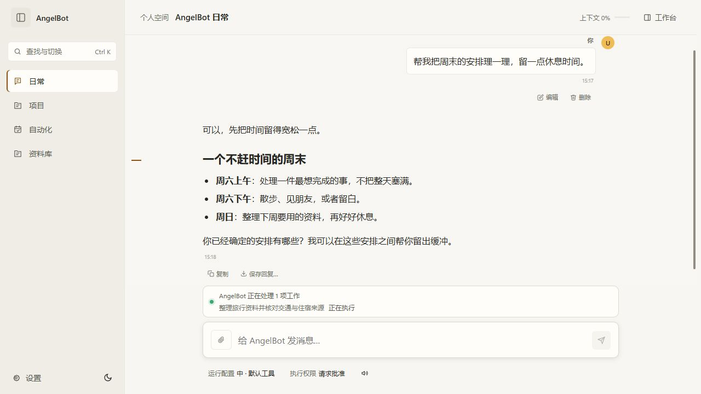
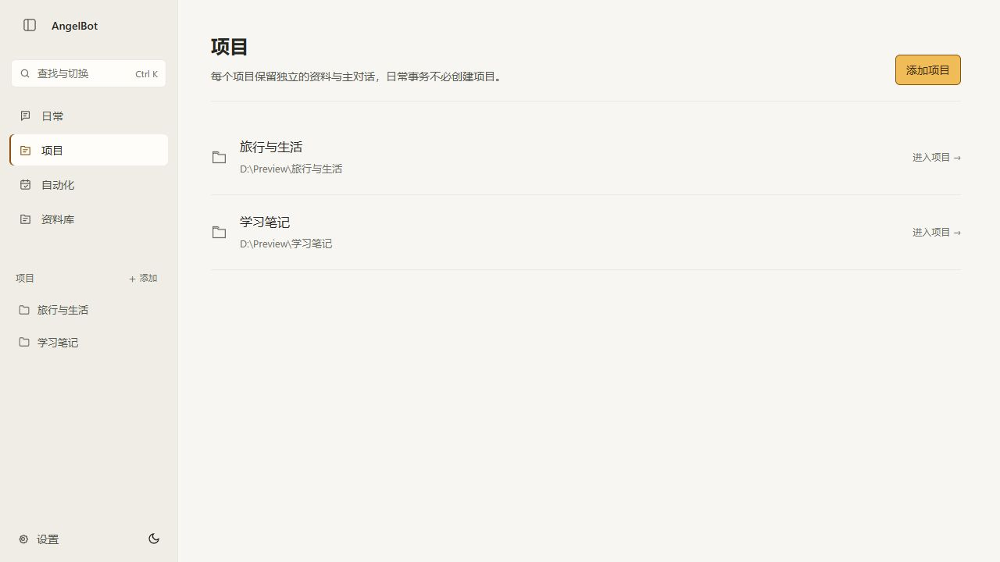
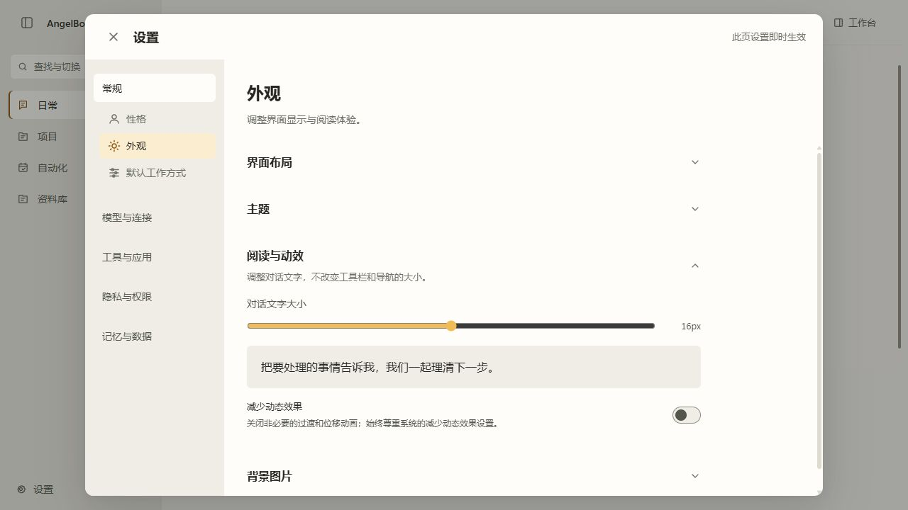

# AngelBot

面向个人使用的开源 Windows AI 助手。日常安排、项目资料和电脑上的小任务，都交给同一位主助手来组织；你不需要在多个子代理会话之间切换。

> **0.2.0 · 开发预览，尚未发布**
>
> 这是一个持续迭代的个人项目，欢迎从小任务开始试用并反馈问题。当前不是稳定发行版，也不承诺通用电脑接管或无人值守完成所有事务。

[查看发布状态](https://github.com/shuimo233/AngelBot/releases) · [反馈问题](https://github.com/shuimo233/AngelBot/issues)

不需要 AngelBot 云账户。会话和资料保存在本机；模型与工具服务由你自行连接，费用及可用额度取决于所选服务。



*截图来自当前应用真实前端的受控预览，使用合成示例数据，不是真实用户会话或模型任务的验收记录。下方截图同样如此。*

## 可以从这些事开始

- **日常对话与安排**：理清待办、整理思路、起草文字，需要时再创建提醒。
- **阅读资料**：把文本、DOCX、XLSX 或 PDF 文字层的快照交给助手，整理摘要、清单和待核对问题。
- **持续的项目工作**：一个文件夹对应一个项目主对话，通过工作台浏览、引用和另存文件；修改按当前权限策略处理。
- **受控电脑操作与自动化**：为受信任应用配置能力，或连接可信 MCP 工具；本地提醒、脚本和模型任务按各自方式执行。

复制、移动和重命名不会覆盖已有目标；正文写入或编辑可能替换原内容。需要批准时，请核对操作目标、拟写内容和风险提示，不要只看模型说“完成了”。

## 开始使用

### 1. 获取并打开

目前可按本文的[源码开发步骤](#从源码开发)在 Windows 上运行 AngelBot。安装包发布后可从 [GitHub Releases](https://github.com/shuimo233/AngelBot/releases) 下载。

首次启动直接进入“日常”。没有配置模型时仍可浏览界面和项目，不会被配置向导挡住。

### 2. 连接模型并保存

打开“设置 → 模型与 API → 管理连接”，选择服务商及接入方式，再选择或填写模型：

- **API Key**：填写相应服务商的密钥和连接地址；密钥保存在系统凭据库。
- **ChatGPT 套餐**：选择 OpenAI，在可用时显式登录并授权套餐用量。可用模型与额度以账户为准，不会自动切换到付费 API。

可以先点“测试连接”；它可能消耗少量额度，但不会保存配置。**授权成功或测试通过后，仍需点击右上角“保存”。**

不同模型的工具与图像能力不同，连接测试通过不代表任意电脑任务都能完成。

### 3. 发送第一个小任务

回到“日常”，试一句：

> 帮我把今晚散步、读十页书和准备明天的待办排成一份轻松的清单。只回复文字，不操作文件或应用。

想处理资料时，可以添加一份不含私人信息的小文件：

> 根据这份资料列出三条要点和仍需核对的问题，不修改原文件。

附件发送的是所选时刻的文字快照，不会授予文件夹访问权限，也不会自动同步原文件变化。

## 日常与项目怎么选

一次性的安排、问题和随手资料留在“日常”。需要持续处理一个文件夹时，打开“项目 → 添加项目”，通过 Windows 文件夹选择器选中目录。

每个项目保留独立资料范围和唯一主对话，文件、浏览器和任务在工作台按需展开；返回日常不代表取消项目任务。



可以先用一个临时项目试：

> 先阅读这个文件夹的关键文件，说明现状、风险和下一步。不要修改任何文件。

确认只读结果符合预期，再提出有明确范围的修改请求。不要把应用已打开、输入已填写或脚本已退出，直接当作业务目标已完成。

## 阅读与外观

“设置 → 外观”支持文字侧栏／图标侧栏两种布局、主题、对话文字大小、减少动态效果和本地背景。布局共用同一份对话与设置；主题可以跟随系统，系统的减少动态效果设置始终优先。

Windows 桌面版的桌宠默认关闭，可从外观设置或托盘打开。拖动可移动桌宠，点击角色可返回当前对话。位置会保留，也可以在外观设置恢复默认位置。



## 人物卡与人设补充

在“设置 → 性格”导入酒馆人物卡，可先预览再应用到草稿，最后保存。支持 V1/V2/V3 JSON 和带卡数据的 PNG 文本人设；中文 PNG 可正常读取，原卡额外字段保留供导出。不处理 CHARX、媒体资产或脚本。

世界书作为可挑选的背景文字：在“人设补充”中选择条目、加入并编辑，也可以直接填写，最多 4096 字。保存的补充会作为固定人设参考随对话提供；留空即可停用。导入卡片不会自动启用世界书，不运行酒馆的关键词、概率或剧情规则。人物卡和补充不改变助手身份、工具权限，也不会自动成为关于你的个人记忆。

“资料库 → 人物卡与世界书”可查看当前人设、已保存的补充和随卡原文，也可以把选中的条目或片段加入人设草稿。确认草稿后在性格设置保存。

## 资料、权限与备份

- 默认资料目录为 `%LOCALAPPDATA%\com.angelbot.desktop`。兼容或迁移回滚模式可能沿用旧目录，不要仅凭默认路径搬动正在使用的资料。
- 连接外部模型或工具时，完成请求所需的内容会交给对应服务。不要发送不希望该服务接触的私人资料。第三方 MCP 服务应来自你信任的来源，环境隔离不等于操作系统沙箱。
- 记忆和学习可以关闭。明确表达的稳定偏好可凭原句记录，推测习惯仍需重复证据；临时任务约定不会因此变成全局偏好。
- 在“设置 → 数据”导出或导入备份。普通导出不加密；密码加密导出可携带 MCP 专用密钥，恢复时写入系统凭据库，不回显原值。

**设置页的普通及密码加密导出，都不包含由模型配置管理的 API Key 或 ChatGPT 登录令牌。** 新环境需要另行配置模型连接或登录。项目文件原件、子代理工作树和自动化执行队列也不包含在这两类导出中，项目原件请另外备份；恢复后需重新确认本机项目目录，不会自动继续旧任务。

以上只描述“设置 → 数据”的导出。复制整个资料目录可能包含受保护的凭据文件，不应把目录冷拷贝视为无凭据备份，也不要直接公开上传原始资料目录。

普通卸载默认保留资料；如果显式选择删除应用数据，资料及其目录内的迁移备份也会删除。备份文件应保存在该目录之外。

<details>
<summary>支持的附件与限制</summary>

- 文本：UTF-8，或带 BOM 的 UTF-16 LE/BE；支持 `txt`、`md`、`csv`、`tsv`、`json`、`log`、`yaml`、`yml`。
- DOCX：提取正文与表格文字，不要求安装 Office；不是完整 Word 版式预览，不读取图片、文本框、页眉页脚、批注、脚注等内容，复杂域和修订会明确拒绝。
- XLSX：提取保存的单元格原始值和合并范围，不计算公式、不按日期／百分比／货币显示格式换算；公式、隐藏内容和复杂扩展会明确拒绝。最多 4 张工作表、4096 个单元格，较大表格可先导出所需部分为 CSV。
- PDF：按页提取文字层，最多 40 页。加密件不读取，扫描件需先 OCR。部分字体或表单内容可能缺失，版式、表格及阅读顺序以原件为准。
- 每次最多 4 个附件；发送的 UTF-8 文字每个最多 16 KiB、合计 32 KiB，DOCX、XLSX 和 PDF 原文件每个最多 4 MiB。不静默截断。
- 暂不支持图片、旧版 `.doc`／`.xls` 和宏工作簿 `.xlsm`。

点击附件名称可在发送前核对实际文字，发送后可从原消息查看同一快照。默认随消息发送全文。开启长期记忆时，可对单个背景附件勾选「按需读取」，模型需要原文时再读取保存的快照。这里的附件限制不等于项目文件台或受信任应用的图像观察能力。

</details>

## 当前需要知道的限制

- 已有自动化检查、隔离脚本模型旅程和 Windows 打包证据；**安装器尚未独立实装验证**，干净环境安装、升级、卸载和恢复也未完成完整验收。
- 本预览包未签名、未启用自动更新；后续版本需从预览发布页手动下载安装。
- 电脑操作依赖已授权应用及可识别的目标，复杂网页、多窗口或特殊控件可能失败。邮件／日历等服务不会因为存在入口就自动接通。
- 定时任务仅在 AngelBot 运行时触发，不会唤醒关机或睡眠中的电脑。本地脚本已在隔离环境验证真实执行、落盘及暂停／停止保护；本轮模型自动化仅核实排队与取消，尚未证明真实模型完成任务。脚本退出成功、MAA 队列结束和控件回执不保证业务目标完成；MAA 的真实游戏队列仍属试用范围。
- 广泛第三方应用、真实模型复杂业务和自然多日稳定性仍在持续改进。结果不明确时先检查实际状态，不要盲目重复可能产生副作用的操作。

这些限制随反馈逐步改进，不把早期测试版包装成稳定版。当前能力和已知问题见 [路线图](docs/current-roadmap.md)。

## 反馈问题

在 [GitHub Issues](https://github.com/shuimo233/AngelBot/issues) 留下：

- AngelBot 版本、Windows 版本、模型名称／服务商。
- 复现步骤、预期结果和实际表现。
- 必要的截图或简短日志；提交前去掉私人内容。

不要提交 API Key、登录令牌、完整数据库或原始个人资料目录。

## 从源码开发

需要 Node.js 20+、Rust stable 及 Windows 构建工具链、WebView2 Runtime。

```powershell
git clone https://github.com/shuimo233/AngelBot.git
cd AngelBot
npm ci
npm run tauri dev
```

`npm run dev` 只运行前端；完整本地能力需要 Tauri 后端。`npm run release:build` 生成本地 Windows 安装候选，产物在 `src-tauri/target/release/bundle/nsis/`。

前端源码在 `src/`，原生应用在 `src-tauri/`，开发与验收脚本在 `scripts/` 和 `e2e/`。产品资料放在 `docs/`，随仓美术放在 `artwork/`。本地设计草稿和生成过程文件放在忽略的 `artwork/local/`，本地验证证据放在 `logs/`。

代码改动按 [开发约定](AGENTS.md) 和 [验证说明](.codex/skills/angelbot-verify/SKILL.md) 执行，统一入口为 `python scripts/verify.py`。产品边界见 [设计原则](docs/design-philosophy.md)，发布约定见 [发布流程](.github/RELEASING.md)。

## 许可

[MIT](LICENSE)。第三方组件保留各自许可，见 [THIRD_PARTY_NOTICES.txt](THIRD_PARTY_NOTICES.txt)。
