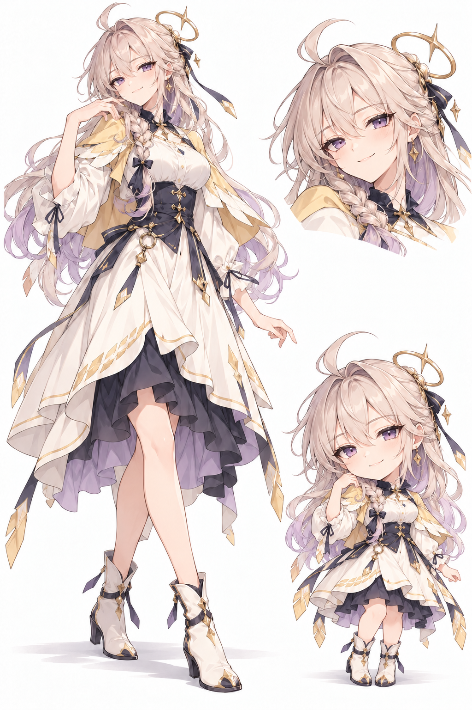

# AngelBot 默认吉祥物

默认吉祥物的立绘、视觉设定和配套素材统一放在这里。后续绘制、宣传图与桌宠制作都从本目录取参考，不再依赖某个临时小样或本机的生成图片目录。

## 当前 Q 版：比例与画风重绘后

这一版是在否定早期 Q 版的头身比例后，重新设计身体比例并改用简洁日式动画画法的版本。它不是设定页右下角的小人，也不是把正常比例立绘压短。桌宠的静态形象参考以这一版为准。

[透明底原图](sd/default-transparent.png) · [白底原图](sd/default-white.png) · [最终画风重绘提示词](prompts/sd-style-redesign.prompt.txt)

## 正常比例立绘与面部参考

下图保留正常比例立绘和面部细节。**右下角是早期 Q 版，不是上面重绘后的版本，不作为当前桌宠比例或画风参考。**

## 默认应用图标（已确认）

2026-10-31 用户确认采用此角色头像式应用图标，沿用当前独立重绘后的 SD 形象，以银白发、紫眼睛、侧辫和金色星环作为识别特征。透明底不含应用名称或快捷方式箭头，避免与 Windows 自身标记重复。

[透明 PNG 原图](icons/angelbot-app-icon-v1.png) · [Windows 多尺寸 ICO](icons/angelbot-app-icon-v1.ico) · [绘制提示词](prompts/app-icon-v1.prompt.txt)

原图与 Windows ICO 是此处的设计基准；`src-tauri/icons/` 为同源的构建用派生资源，保持原文件名以兼容现有配置。窗口及安装包复用 Tauri 图标配置，托盘显式复用默认窗口图标，前端页签引用同一份32px PNG。源 PNG 保留内置生图的原始字节，ICO 使用项目现有 Tauri 图标工具生成，包含16、24、32、48、64和256像素六档。当前运行窗口不自动重启，图标随后续应用构建生效。

重新生成规格时复用 `npm run tauri -- icon artwork/mascot/icons/angelbot-app-icon-v1.png --output logs/app-icon-regenerate`。仅将既有的 `32x32.png`、`128x128.png`、`128x128@2x.png`、`icon.png`、`icon.ico`、`icon.icns` 同名产物更新到 `src-tauri/icons/`；保留的 `icon-256.png` 兼容文件使用 `128x128@2x.png` 的同一份256px数据。不导入额外移动端资源，不变更角色设计。

## 素材入口

| 内容 | 文件 | 使用范围 |
| --- | --- | --- |
| 正常比例立绘与面部参考 | [角色设定页](reference/character-sheet.png) | 以左侧全身与右上面部为基准；右下为早期 Q 版参考，不作为当前桌宠比例标准 |
| 当前 Q 版／SD 形象（比例与画风重绘后） | [透明底版本](sd/default-transparent.png) · [白底版本](sd/default-white.png) | 2026-10-22 后续独立重绘的版本：简化轮廓、较明确的描线与赛璐璐色块；不沿用设定页右下角的旧比例 |
| 月夜庭园插画 | [原图](illustrations/angelbot-moonlit-garden-v1.png) · [提示词](prompts/angelbot-moonlit-garden-v1.prompt.txt) | 正常比例形象的暖色夜景演绎 |
| 海风日光插画 | [原图](illustrations/angelbot-seabreeze-daylight-v1.png) · [提示词](prompts/angelbot-seabreeze-daylight-v1.prompt.txt) | 正常比例形象的冷色日景演绎 |
| 阅读分件 | [角色与书本分层图](companion/reading-parts.png) | 桌宠分层实验的基础素材 |
| 游戏道具 | [双手与手柄](companion/gamepad-back-hands.png) | 使用修正握持与朝向后的版本 |
| 茶歇道具 | [双手与杯碟](companion/tea-saucer-hands.png) | 一手托碟、一手握柄的版本 |

来源、图像规格和内容校验值见 [素材来源](ASSETS.md)，道具绘制说明见 [桌宠道具提示词](prompts/companion-props.md)。

## 角色视觉设定

整体是日式二次元女性人形：表情自然、亲近而有精神，保留正常比例立绘的优雅感。SD 是同一人的简化表达，不画成另一位角色，也不沿用早期大头缩身的处理。具体比例以当前 SD 图为准，不另设未经确认的头身数字。

主要识别特征：

- 香槟银白色长发，发尾与内层带浅薰衣草紫；弧形呆毛、自然刘海、肩前粗侧辫。
- 紫色眼睛，放松、略带笑意的神态；面部不做夸张呆萌处理。
- 偏侧、倾斜的金色轨道光环与四芒星，搭配细小星形饰物及深蓝蝴蝶结。
- 象牙白宽松衣袖、浅金色短肩披、深色领结，以及深蓝灰束腰。
- 不对称象牙白外裙、深紫蓝内裙与浅紫褶边，配金色几何边饰、腰间圆环与垂坠星饰。
- 深色长飘带与金色末端、象牙白短靴及深蓝系带。

基准配色为象牙白、香槟银、深蓝灰、浅薰衣草紫，金色用于少量结构和饰物。场景插画可以改变光照和环境色，但不以夜景暖色或海景青蓝重新定义角色本色。侧辫、光环、服装轮廓和装饰位置应参考设定图，不随意镜像或换装成另一套设计。

## 桌宠动作与道具约束

桌宠沿用轻量分层骨架的方向：头部、头发、躯干和道具做连续的小幅运动，不以大量整个人物图片轮播替代动作设计，也不要求虚拟主播级模型精度。

- 阅读：书与双手保持稳定关系；现有抬书动作不等于翻页。
- 游戏：人物面向观众时，观众应看到手柄背壳，按键面朝向人物；双手自然握住两侧，不能为了展示按键把手柄转向观众。
- 茶歇：画面一侧的手从下方托住碟子，另一侧握杯柄；杯子落在碟上，杯碟联动并保持平稳。
- 切换活动时不叠出第二双手；脚底基线稳定，眨眼不叠出重影；不使用抬手招呼作为默认动作。
- 对话气泡保持轻量，不遮挡脸部、不抢焦点，不把纯视觉活动描述成实际完成的工作。

`companion/` 目前保存的是分层实验素材，不是可以直接导入应用的完整骨骼模型包。这里也没有将场景插画或设定页冒充透明的单人立绘。

## 维护方式

继续使用现有角色，不在素材归档中新增名字、年龄、身世或强制性格设定。这些图片不修改 Main Agent 的记忆、权限或模型配置；用户仍可选择自己的专属形象。

新增素材按用途放进 `reference/`、`sd/`、`illustrations/`、`companion/`、`icons/` 或 `prompts/`，再更新本页与 [素材来源](ASSETS.md)。被否定的握持姿势、朝向错误稿和旧版候选不混入当前基准。修改原图时创建带版本号的新文件，不覆盖基准文件。

原有参考素材整理保留图片原始像素与分辨率，只归档和改名。应用图标使用上述已确认版本，不改写立绘或 SD 参考基准；未修改既有素材许可或包含第三方参考图库。
